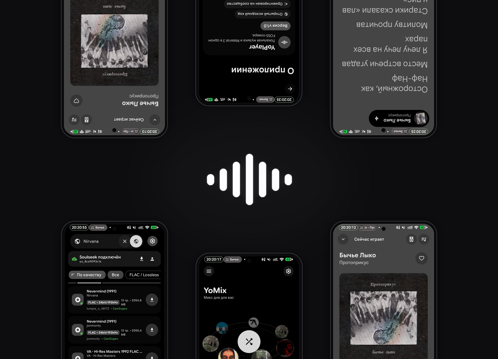

<p align="center">
  
</p>

<h1 align="center">YoPlayer</h1>

<p align="center">
  <b>A modern, local-first Android Hi-Res audio player with Bit-Perfect USB DAC output, built-in Soulseek FLAC search, synced online lyrics, and Material 3 Expressive design.</b>
</p>

<p align="center">
  <a href="https://rdkgl.github.io/YoPlayer">
    
  </a>
  <a href="https://github.com/RDKGL/YoPlayer/releases/latest">
    
  </a>
  
  
  <a href="https://github.com/PixelPlayerHQ/PixelPlayerOSS">
    
  </a>
</p>

---

## 🎵 Overview

**YoPlayer** (`com.yoopen.player`) is a free, open-source, audiophile-grade local music player for Android built with Jetpack Compose and **Material 3 Expressive** guidelines. No subscriptions, no ads, no tracking — just your lossless library, direct hardware USB DAC output, and built-in P2P FLAC discovery.

---

## ✨ Key Features

### 🎧 Audiophile Sound Engine & Bit-Perfect USB DAC
- **Direct USB DAC Output 2.0**: Native C++ lock-free Isochronous PCM ring buffer (`USBDEVFS`) streaming raw audio directly to external USB DACs, bypassing the Android system mixer. Supports 16-bit and 24-bit PCM, dynamic sample-rate switching (`44.1 / 48 / 96 / 192 kHz`), and clean hot-plug lifecycle handling.
- **Audio Inspector Sheet**: Tap the format badge in Now Playing to inspect codec, sample rate, bit depth, bitrate (`LOSSLESS` / `HI-RES` badges), full signal path (`Source ➔ Audio Engine ➔ Output Device`), and hardware DAC master gain.
- **AutoEQ Headphone Correction**: Built-in Harman Target compensation profiles for popular headphones (Sony WH-1000XM4/XM5, Sennheiser HD600/650, AirPods Pro/Max, KZ ZSN Pro, Audio-Technica ATH-M50x, Galaxy Buds, and more).
- **10-Band Graphic Equalizer**: Precision EQ with Bass Boost, Virtualizer, and Loudness Enhancer.

### 🌐 Built-in Soulseek (Seeker-Style P2P Search & Downloads)
- **Native Kotlin Soulseek Client**: Toggle the globe icon right in the Search bar to search the Soulseek P2P network without leaving YoPlayer.
- **Album / Folder Grouping**: Search results are grouped into clean album cards showing track count, total size, format badge (`FLAC • 24bit/192kHz`, `320 kbps`), peer speed, and free-slot status.
- **Selective Track Download & Sorting**: Open any album to download individual tracks or the entire folder; sort by quality, speed, free slots, or relevance, and filter by `FLAC / Lossless` or `320 kbps`.
- **Downloads Manager & Auto-Library Scan**: Track live transfer progress, cancel/retry downloads, and save directly to `Music/YoPlayer` with automatic MediaStore indexing.

### 🧠 Synced Lyrics, Smart YoMix & Library
- **Online Synced Lyrics**: Automatic LRC lyrics fetching with smooth karaoke-style line highlighting and instant switching between **Synced** and **Static** modes.
- **YoMix Orbital Discovery**: Smart daily mix and dynamic auto-queue balancing play engagement, favorites, artist/genre similarity, and diversity spacing.
- **Built-in Tag Editor**: Edit ID3v2 and FLAC metadata directly inside the app.

### 🎨 Material 3 Expressive UI & Customization
- **4 Cover Art Styles**: **Standard** (rounded), **Vinyl** (spinning record), **Glow** (ambient breathing aura), and **Circle**.
- **Expressive Player Controls**: Squircle/pill transport buttons, animated wavy seekbar, and a live preview customizer for typography size, title alignment, and artwork position.
- **Dynamic Theming**: Material You palette extraction from album art, OLED True-Black mode, customizable navigation bar, and instant cold start without splash-screen delays.

---

## 🛠️ Build Requirements

| Component | Minimum Version |
| --- | --- |
| Android OS | 11.0+ (API Level 30+) |
| Java Development Kit | JDK 21 |
| Android SDK Target | API Level 37 |
| Build System | Gradle 8.11+ |

```sh
# Clone repository
git clone https://github.com/RDKGL/YoPlayer.git
cd YoPlayer

# Assemble Release APK
./gradlew :app:assembleRelease
```

---

## 📄 License & Acknowledgments

YoPlayer is licensed under the **GNU General Public License v3.0 (GPL-3.0)**.
Originally forked from [PixelPlayerHQ/PixelPlayerOSS](https://github.com/PixelPlayerHQ/PixelPlayerOSS).
