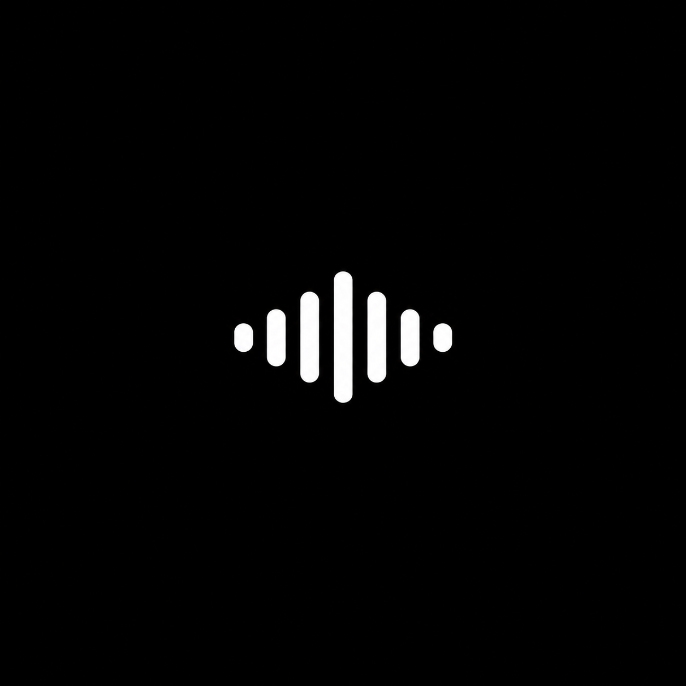
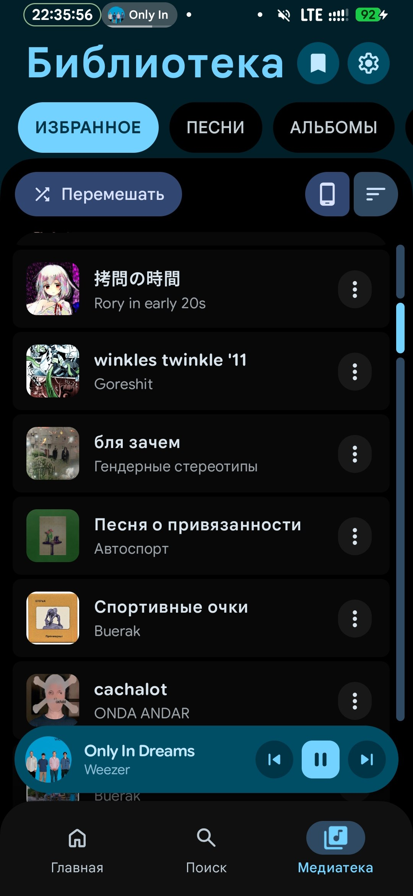

<p align="center">
  
</p>

<h1 align="center">YoPlayer</h1>

<p align="center">
  <b>A modern, local-first Android audio player with Bit-Perfect USB DAC support, AutoEQ headphone correction, and smart recommendations.</b>
</p>

<p align="center">
  <a href="https://github.com/RDKGL/YoPlayer/releases/latest">
    
  </a>
  
  
  <a href="https://github.com/PixelPlayerHQ/PixelPlayerOSS">
    
  </a>
</p>

<p align="center">
  
  
  
  
</p>

---

## 🎵 Overview

**YoPlayer** (`open.yo.player`) is an open-source, audiophile-grade local audio player for Android built with Jetpack Compose and Material 3 Expressive guidelines. Designed for speed, flexibility, and pure high-resolution sound quality.

---

## ✨ Key Features

### 🎧 Audiophile Sound Engine & Bit-Perfect USB DAC
- **Direct USB DAC Output**: Native C++ lock-free PCM ring buffer engine streaming raw audio directly to external USB DACs, bypassing the Android system audio mixer.
- **AutoEQ Headphone Integration**: Built-in target compensation profiles for popular headphones (Sony WH-1000XM4/XM5, Sennheiser HD600/650, AirPods Pro/Max, KZ ZSN Pro, Audio-Technica ATH-M50x, Galaxy Buds, etc.) powered by Harman Target curves.
- **Audio Quality Badge**: Live playback format badge showing container format, sample rate (kHz), bit depth (16-bit / 24-bit / 32-bit), bitrate (kbps), and active `⚡ Bit-Perfect USB` routing status.
- **10-Band Graphic Equalizer**: Advanced audio processing with Bass Boost, Virtualizer, and Loudness Enhancer.

### 🧠 Smart YoMix Queue & Library
- **Intelligent YoMix Recommendation**: Smart dynamic queue generator balancing track engagement (play count & duration), favorite status, artist & genre similarity, recency penalty, and artist diversity spacing.
- **Dynamic Auto-Queue**: Seamless auto-fill recommendations to keep playback flowing.
- **Tag Editing & Lyrics**: Built-in ID3v2/FLAC metadata editor and synced LRC lyrics integration.

### 🎨 Material 3 Expressive UI & Customization
- **Player View Customization**:
  - **Title Alignment**: Left / Center / Right alignment settings.
  - **Title Position**: Adjust track title height and artwork placement.
  - **Ergonomic Swapped Buttons**: Favorite heart button placed top next to title; Lyrics button placed in the bottom action bar.
- **Dynamic Theming**: Album art palette extraction, OLED True-Black mode, customizable navigation layouts.
- **Instant Launch**: Optimized cold start without splash screen delays.

---

## 🛠️ Build Requirements

| Component | Minimum Version |
| --- | --- |
| Android OS | 11.0+ (API Level 30+) |
| Java Development Kit | JDK 21 |
| Android SDK Target | API Level 37 |
| Build System | Gradle 8.11+ |

```sh
# Clone repository
git clone https://github.com/RDKGL/YoPlayer.git
cd YoPlayer

# Assemble Release APK
./gradlew :app:assembleRelease
```

---

## 📄 License & Acknowledgments

YoPlayer is licensed under the **GNU General Public License v3.0 (GPL-3.0)**.
Originally forked from [PixelPlayerHQ/PixelPlayerOSS](https://github.com/PixelPlayerHQ/PixelPlayerOSS).
