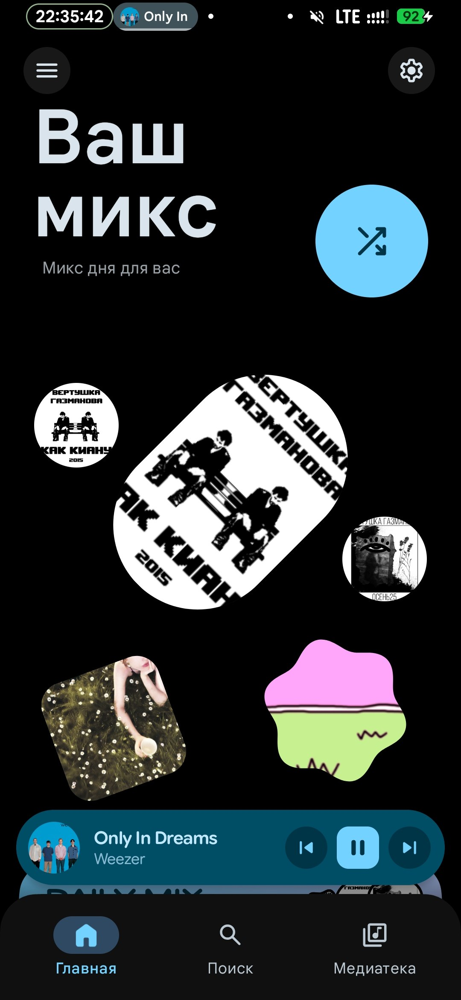
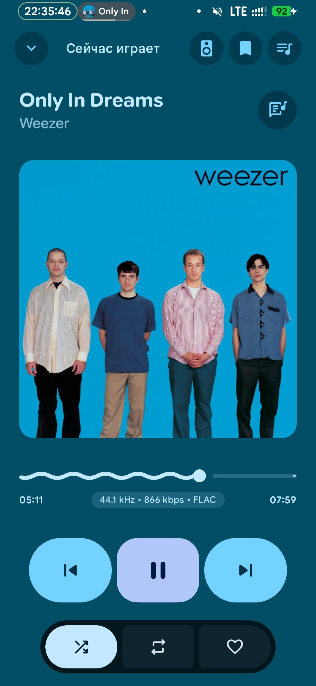
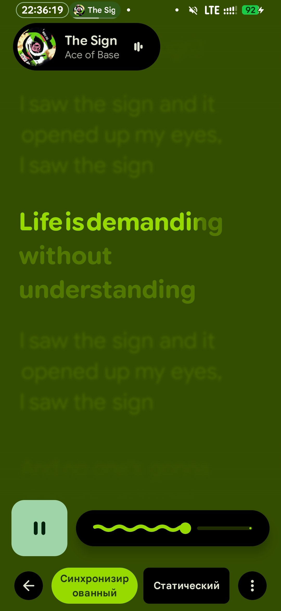

<p align="center">
  
</p>

<p align="center">
  <a href="https://github.com/RDKGL/YoPlayer/releases/latest">
    
  </a>
  
  
  <a href="https://github.com/PixelPlayerHQ/PixelPlayerOSS">
    
  </a>
</p>

<p align="center">
  
  
  
  
</p>

---

## 🎵 What is YoPlayer?

**YoPlayer** is an open-source, local-first Android music player built with Jetpack Compose and Material 3 Expressive UI guidelines.

Package Name: `open.yo.player` | Current Version: `v0.1.0`

---

## ✨ Features

- 🎧 **Player View Customization ("Вид плеера")**:
  - **Track Title Alignment**: Left / Center.
  - **Track Title Position**: Below Artwork / Above Artwork.
  - **Custom Actions Bar**: Swapped Favorite heart and Lyrics buttons for quicker access.
- 🔌 **USB DAC Direct Audio Output**:
  - Optional bit-perfect direct output mode for external USB DACs and audiophile IEMs.
- ⚡ **Instant Startup**:
  - Removed startup splash delay for instant app launch.
- 🎶 **Local Music Library & Scanner**:
  - Supports MP3, FLAC, WAV, AAC, OGG, M4A, tag editing, lyrics sync, smart playlists, and listening statistics.
- 🎨 **Material 3 Expressive UI**:
  - Dynamic palette color extraction from album art, AMOLED true-black dark mode, custom navigation.
- 🌍 **Multi-Language Support**:
  - Fully translated across 13 locales.

---

## 🛠️ Requirements & Building

| Requirement | Version |
| --- | --- |
| Android | 11.0+ (API 30+) |
| JDK | 21 |
| Android SDK | Compile/Target API 37 |

```sh
# Clone repo
git clone https://github.com/RDKGL/YoPlayer.git
cd YoPlayer

# Build Release APK
./gradlew :app:assembleRelease
```

---

## 📄 License & Credits

YoPlayer is licensed under the **GNU General Public License v3.0 (GPL-3.0)**.
Fork of [PixelPlayerHQ/PixelPlayerOSS](https://github.com/PixelPlayerHQ/PixelPlayerOSS).
